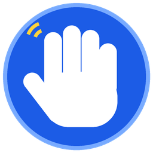
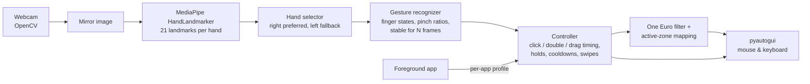

<p align="center">
  
</p>

<h1 align="center">Hand Gesture Control</h1>

<p align="center"><b>Control your Windows mouse and keyboard with hand gestures through your webcam - live, smooth and 100% local.</b></p>

<!-- DEMO GIF: record a short clip (e.g. with ScreenToGif), save it as docs/demo.gif and replace this comment with:
<p align="center"></p>
-->
<p align="center"><i>🎬 Demo GIF coming soon</i></p>

<p align="center">
  <a href="docs/user-guide.pdf"><b>📘 User Guide (PDF)</b></a> &nbsp;·&nbsp;
  <a href="docs/gesture-cheat-sheet.pdf"><b>🖐️ Gesture Cheat Sheet (PDF)</b></a>
</p>

---

## Contents

- [Features](#features)
- [How it works](#how-it-works)
- [Tools and libraries](#tools-and-libraries)
- [Requirements](#requirements)
- [Installation](#installation)
- [Usage](#usage)
- [Gestures](#gestures)
- [Per-app profiles](#per-app-profiles)
- [Configuration](#configuration)
- [Tips for best results](#tips-for-best-results)
- [Troubleshooting](#troubleshooting)
- [Developer guide: add a new gesture or action](#developer-guide-add-a-new-gesture-or-action)
- [Privacy](#privacy)
- [Roadmap](#roadmap)
- [License](#license)

---

## Features

- **Full mouse control** - move, left click, double click, drag & drop, right click, scroll.
- **Zoom & 3D** - three-finger zoom, VR-style two-hand zoom, four-finger rotate/orbit for 3D apps and Google Earth.
- **Media & shortcuts** - volume up/down, play/pause, Enter, screenshot, on-screen keyboard, swipes for app switching, task view and show desktop.
- **Per-app profiles** - gestures adapt automatically to the app in front (browser back/forward, PowerPoint slides, Google Earth and Blender zoom).
- **Either hand** - right hand preferred, left hand takes over when the right one is out of view.
- **Feels smooth, not janky**
  - One Euro filter removes jitter but keeps the cursor responsive.
  - Active zone: a small rectangle in the camera image maps to the whole screen.
  - Cursor freezes while you click, so clicks land where you aimed.
  - Every gesture must be stable for a few frames; cooldowns stop double fires.
  - Pinch detection is relative to hand size, so it works near and far from the camera.
- **Safe**
  - Starts **paused**; fist / open palm pause and resume.
  - Global hotkeys: **Ctrl+Alt+Q** quit, **Ctrl+Alt+P** pause/resume.
  - pyautogui fail-safe kept: push the real mouse into a screen corner to stop.
  - Held mouse buttons are always released (on exit, pause, hand lost, hand switch).
- **Helpful UI** - live preview with hand skeleton, finger names, gesture name, mode, FPS, hold progress bar, and a gesture help panel (**H**).
- **Calibration** - a guided 4-step helper measures your hand and sets the thresholds for you.
- **Configurable and modular** - every setting and every gesture → action mapping lives in `config.json`.
- **Runs at ~30 FPS** on a normal laptop (camera at 640×480).

## How it works



1. **Camera** (`src/camera.py`) grabs frames on a background thread and keeps only the newest one, so there is no lag build-up.
2. **Hand tracking** (`src/hand_tracker.py`) runs MediaPipe's HandLandmarker (Tasks API) and returns 21 landmarks per hand.
3. **Gesture recognition** (`src/gestures.py`) turns landmarks into a pose ("point", "pinch", "fist", ...). All distances are divided by the hand size, so thresholds work at any distance. A pose must repeat for a few frames before it counts.
4. **Controller** (`src/controller.py`) adds timing: tap vs. hold, double click, hold-to-trigger gestures, cooldowns, swipes, two-hand zoom and per-app profiles.
5. **Smoothing** (`src/smoothing.py`) applies a One Euro filter, and the active zone maps a rectangle of the camera image to the full screen.
6. **Actions** (`src/actions.py`) send the real mouse and keyboard input through pyautogui.

## Tools and libraries

| Library | Why it is used |
|---|---|
| **Python 3.12** | Main language; simple and has great computer-vision libraries. |
| **OpenCV** (`opencv-contrib-python`) | Reads the webcam and draws the preview window. The contrib build is used because MediaPipe depends on it (installing both builds causes conflicts). |
| **MediaPipe** (Tasks API, HandLandmarker) | Detects hands and returns 21 3D landmarks per hand, fast enough for real time on a CPU. |
| **NumPy** | Fast vector math on landmark coordinates. |
| **pyautogui** | Moves the mouse, clicks, scrolls and presses keys; has a built-in fail-safe. |
| **pynput** | Global hotkeys (Ctrl+Alt+Q / Ctrl+Alt+P) that work even when the preview is not focused. |
| **pytest** | Unit tests with synthetic hand data - no camera needed. |

## Requirements

- **Windows 10 or 11** (64-bit)
- **Python 3.9 - 3.12** (MediaPipe does not support newer versions yet)
- A **webcam** (built-in is fine)
- **Microsoft Visual C++ Redistributable 2015-2022 (x64)** - needed by MediaPipe ([download](https://aka.ms/vs/17/release/vc_redist.x64.exe))
- Internet once, to download the hand model (~8 MB) on first run

## Installation

```bash
# 1. Get the code
git clone https://github.com/Khansuhai/hand-gesture-control.git
cd hand-gesture-control

# 2. Create a virtual environment (keeps packages inside this folder)
python -m venv .venv

# 3. Install the packages
.venv\Scripts\python.exe -m pip install -r requirements.txt

# 4. Run it (starts paused - hold an open palm to begin)
.venv\Scripts\python.exe main.py --start-paused
```

On the first run the MediaPipe model `models/hand_landmarker.task` is downloaded automatically.

**Optional - run the tests:**

```bash
.venv\Scripts\python.exe -m pytest
```

## Usage

### Double-click launchers

| File | What it does |
|---|---|
| `start.bat` | Real control, starts **PAUSED** (hold an open palm 🖐️ to begin) |
| `start-dry-run.bat` | Practice mode: shows gestures, clicks nothing |
| `calibrate.bat` | Measures your hand and saves matching thresholds to `config.json` |

**Desktop icon:** right-click `start.bat` → *Send to* → *Desktop (create shortcut)*, then right-click the shortcut → *Properties* → *Change Icon* → choose `assets\icon.ico`.

### Command line

```bash
python main.py [options]
```

| Option | Meaning |
|---|---|
| `--dry-run` | Detect gestures but do not move or click anything |
| `--no-preview` | Hide the camera window (quit with Ctrl+Alt+Q) |
| `--start-paused` | Start in PAUSED mode |
| `--camera N` | Use camera number N (overrides config) |
| `--hand right\|left\|any` | Preferred hand (overrides config) |
| `--calibrate` | Run the calibration helper |
| `--config PATH` | Use another config file |

### Hotkeys

| Keys | Action |
|---|---|
| **Ctrl+Alt+Q** | Quit instantly (works anywhere) |
| **Ctrl+Alt+P** | Pause / resume |
| **Esc** | Quit (when the preview window is focused) |
| **H** | Show / hide the gesture help panel in the preview |
| Real mouse into a screen corner | Emergency stop (pyautogui fail-safe) |

## Gestures

### Mouse

| Gesture | How to do it | Action |
|---|---|---|
| ☝️ Point | Index finger up, others down | Move cursor (fingertip controls it) |
| 🤏 Pinch | Quick thumb + index tap | Left click |
| 🤏🤏 Double pinch | Two quick taps | Double click |
| 🤏⏳ Pinch & hold | Hold thumb + index > 0.4 s, move, open to drop | Drag & drop |
| 👌 Middle pinch | Thumb + middle fingertip | Right click |
| ✌️ V sign | Index + middle up, move hand up/down (joystick) | Scroll |

### Zoom, 3D and volume

| Gesture | How to do it | Action |
|---|---|---|
| 🖖 Three fingers | Index + middle + ring up, move up/down | Zoom (Ctrl + wheel) |
| 🤚 Four fingers | All fingers up, thumb folded, move hand | Rotate / orbit (middle-button drag) |
| 🙌 Two-hand pinch | Pinch with both hands, pull apart / push together | Zoom in / out |
| 🤙 Call-me | Thumb + pinky out, move up/down | Volume up / down |

### Hold gestures

| Gesture | Hold | Action |
|---|---|---|
| 👍 Thumbs up | 0.7 s | Enter |
| 🤘 Rock sign (index + pinky) | 0.6 s | Play / Pause media |
| 👎 Thumbs down | 0.8 s | On-screen keyboard (Win+Ctrl+O) |
| Pinky only | 0.8 s | Screenshot (Win+Shift+S) |
| ✊ Fist | 1 s | **Pause** control |
| 🖐️ Open palm | 1 s | **Resume** control |

### Swipes (open palm, quick flick)

| Swipe | Default action |
|---|---|
| ⬅️ Left | Switch app (Alt+Shift+Tab) |
| ➡️ Right | Switch app (Alt+Tab) |
| ⬆️ Up | Task view (Win+Tab) |
| ⬇️ Down | Show desktop (Win+D) |

A still palm never triggers a swipe - only a fast movement does.

## Per-app profiles

The app checks which program is in front twice a second and switches gestures automatically (the preview shows *App profile: ...*).

| App | Changes |
|---|---|
| Chrome, Edge, Firefox, Brave, Opera | Swipe ← / → = Back / Forward |
| PowerPoint | Swipe ← / → = previous / next slide |
| Google Earth Pro | Three-finger and two-hand zoom use the plain mouse wheel; swipe ← / → = arrow keys |
| Blender | Three-finger and two-hand zoom use the plain mouse wheel (four fingers = orbit) |

Add your own under `"profiles"` in `config.json` (see below).

## Configuration

All settings are in **`config.json`**. You only need to change what you want - anything missing falls back to the built-in default. Keys starting with `_` are comments. After editing, restart the app. If a value is invalid, the app tells you which one and why.

### `camera`
| Setting | Default | Meaning |
|---|---|---|
| `index` | `0` | Which camera to use (0 = first) |
| `width`, `height` | `640`, `480` | Capture resolution. Lower = faster |
| `fps` | `30` | Requested camera frame rate |
| `backend` | `"dshow"` | Windows camera API: `dshow`, `msmf` or `any` (others are tried automatically if it fails) |
| `mirror` | `true` | Mirror the image so moving right moves the cursor right |

### `tracking`
| Setting | Default | Meaning |
|---|---|---|
| `hand` | `"right"` | Preferred hand: `right`, `left` or `any` |
| `use_other_hand_if_missing` | `true` | Let the other hand take over when the preferred one is not visible |
| `switch_delay_s` | `0.3` | How long the preferred hand must be gone before the other hand takes over |
| `max_hands` | `2` | Hands to detect (2 needed for two-hand zoom and hand switching) |
| `min_detection_confidence` | `0.6` | How sure MediaPipe must be to detect a new hand |
| `min_presence_confidence` | `0.5` | How sure it must be that the hand is still there |
| `min_tracking_confidence` | `0.5` | How sure it must be to keep tracking between frames |
| `model_path` | `"models/hand_landmarker.task"` | Where the model is stored |
| `model_url` | Google storage URL | Where the model is downloaded from on first run |

### `active_zone`
Fractions of the camera image cut off on each side; the rectangle left in the middle maps to the full screen (drawn yellow in the preview).

| Setting | Default |
|---|---|
| `left`, `right` | `0.2`, `0.2` |
| `top`, `bottom` | `0.12`, `0.38` |

### `smoothing`
| Setting | Default | Meaning |
|---|---|---|
| `min_cutoff` | `1.0` | One Euro filter: lower = smoother when still, but more lag |
| `beta` | `0.005` | Higher = less lag when moving fast |
| `d_cutoff` | `1.0` | Smoothing of the speed estimate (rarely needs changing) |
| `offset_absorb` | `0.4` | How quickly hand and cursor re-align after a freeze (0-0.9) |

### `gestures` (set automatically by `calibrate.bat`)
| Setting | Default | Meaning |
|---|---|---|
| `stable_frames` | `3` | Frames a pose must repeat before it counts |
| `finger_extended_ratio` | `1.15` | Fingertip/joint distance ratio above which a finger is "up" |
| `thumb_extended_ratio` | `0.5` | Thumb tip distance (÷ hand size) above which the thumb is "out" |
| `thumb_up_min_alignment` | `0.7` | How vertical the thumb must be for thumbs up/down (1 = straight) |
| `pinch_on_ratio` | `0.25` | Thumb-tip to fingertip distance (÷ hand size) that starts a pinch |
| `pinch_off_ratio` | `0.35` | Distance that ends a pinch (bigger = no flicker) |
| `pinch_min_extension` | `0.85` | Finger must be at least this extended to pinch (stops a fist looking like a pinch) |
| `pinch_freeze_ratio` | `0.4` | Cursor freezes when fingers get this close, just before a click |

### `timing`
| Setting | Default | Meaning |
|---|---|---|
| `drag_hold_s` | `0.4` | Pinch held longer than this = drag instead of click |
| `double_click_window_s` | `0.4` | Max time between two taps for a double click |
| `release_freeze_s` | `0.25` | Cursor stays still this long after a click (for double clicks) |
| `hand_lost_grace_s` | `0.3` | Short tracking dropouts shorter than this are ignored |
| `hold_times_s` | see file | Per-gesture hold time before it fires (thumbs_up 0.7, fist 1.0, ...) |
| `cooldowns_s` | see file | Per-gesture minimum time between two triggers |
| `default_cooldown_s` | `0.3` | Cooldown for gestures not listed above |

### `scroll`, `zoom`, `volume`
| Setting | Default (scroll / zoom / volume) | Meaning |
|---|---|---|
| `mode` | `joystick` | `joystick`: distance from start point sets the speed. `drag`: follows hand movement like a touchpad |
| `speed` | `8` / `3` / `10` | Steps per second at 10 % of frame height (joystick) or per 10 % moved (drag) |
| `deadzone` | `0.03` | Small movements near the start point are ignored |
| `invert` | `false` | Reverse direction |

### `rotate`
| Setting | Default | Meaning |
|---|---|---|
| `button` | `"middle"` | Mouse button held while rotating: `left`, `middle`, `right` |
| `modifier` | `"none"` | Key held too: `none`, `shift`, `ctrl`, `alt` (Fusion 360 uses `shift`) |
| `speed` | `1.0` | Multiplies hand movement while rotating |

### `swipe`
| Setting | Default | Meaning |
|---|---|---|
| `min_distance` | `0.22` | How far (fraction of frame) the palm must travel |
| `max_time_s` | `0.35` | ...within this time |
| `cooldown_s` | `0.6` | Ignore further swipes for this long (no double swipes) |

### `two_hand`
| Setting | Default | Meaning |
|---|---|---|
| `speed` | `4.0` | Wheel notches per 10 % of frame width the hands move apart |
| `invert` | `false` | Reverse direction |

### `gesture_actions`
Maps each gesture/event to an action. Set a gesture to `null` (or `"none"`) to turn it off.

| Action | What it does |
|---|---|
| `left_click`, `right_click`, `middle_click`, `double_click` | Mouse clicks |
| `move`, `scroll`, `zoom`, `volume`, `rotate`, `drag` | Continuous actions |
| `pause`, `resume`, `toggle_pause` | Control the app itself |
| `key:<name>` | Press a key, e.g. `key:enter`, `key:volumeup`, `key:playpause`, `key:f5` |
| `hotkey:<a>+<b>` | Key combination, e.g. `hotkey:alt+tab`, `hotkey:ctrl+c`, `hotkey:win+d` |
| `type:<text>` | Type text |

Gesture/event names: `point`, `pinch`, `double_pinch`, `pinch_hold`, `middle_pinch`, `two_fingers`, `three_fingers`, `four_fingers`, `two_hand_pinch`, `call_me`, `thumbs_up`, `thumbs_down`, `rock`, `pinky`, `fist`, `open_palm`, `swipe_left`, `swipe_right`, `swipe_up`, `swipe_down`.

### `profiles`
```json
"profiles": {
  "vlc": {
    "match": ["vlc.exe"],
    "gesture_actions": { "rock": "key:space", "swipe_right": "key:right" }
  }
}
```
`match` lists program names (as in Task Manager → Details). A profile can override `gesture_actions`, `scroll`, `zoom`, `rotate`, `volume`, `two_hand` and `swipe`.

### `ui`
| Setting | Default | Meaning |
|---|---|---|
| `preview` | `true` | Show the camera window |
| `window_scale` | `1.0` | Make the preview bigger/smaller |
| `show_debug` | `true` | Show finger states and pinch numbers at the bottom |

## Tips for best results

- **Distance:** 50-80 cm from the camera, palm facing it.
- **Lighting:** light from the front; avoid a bright window behind you.
- **Background:** plain backgrounds track best.
- **Stay in the yellow rectangle** - it already covers the whole screen.
- **Make gestures clearly** and hold them still for a moment.
- **Run `calibrate.bat`** if clicks trigger too easily or too hard.
- Move your hand **out of view** when you are not using it.

## Troubleshooting

| Problem | Solution |
|---|---|
| `ImportError: DLL load failed` | Install the [Visual C++ Redistributable 2015-2022 x64](https://aka.ms/vs/17/release/vc_redist.x64.exe) and restart. |
| "Could not open camera" | Close apps using the camera (Zoom, Teams, Camera app, browser tabs). Check *Settings → Privacy & security → Camera* allows desktop apps. Try `--camera 1`. |
| `mediapipe` will not install | Your Python is too new or 32-bit. Install 64-bit **Python 3.11 or 3.12** and recreate `.venv`. |
| Laggy or shaky cursor | Better light, hand closer, close heavy apps. Check FPS in the preview (25+ is good). Tune `smoothing` (`min_cutoff` lower = smoother, `beta` higher = less lag). |
| Clicks become drags | Pinch quicker, or raise `timing.drag_hold_s`. |
| Double click does not work | Pinch faster; the two taps must be within `double_click_window_s`. |
| Pauses by itself | A relaxed closed hand counts as a fist. Move the hand out of view, or raise `hold_times_s.fist`. |
| Wrong hand controls | Set `tracking.hand`, or `use_other_hand_if_missing: false`. |
| App stopped with "Fail-safe" | The real mouse touched a screen corner - that is the emergency stop. Start again. |
| Multi-monitor | The cursor is mapped to the **primary** screen. Extra monitors need extra work (see Roadmap). |

## Developer guide: add a new gesture or action

The project is modular - most additions are a few lines.

```
main.py              entry point, CLI, main loop
src/camera.py        threaded webcam capture
src/hand_tracker.py  MediaPipe HandLandmarker wrapper (+ model download)
src/gestures.py      poses, hand selector, swipe and two-hand detectors
src/controller.py    timing, clicks, drags, holds, cooldowns, profiles
src/actions.py       mouse/keyboard actions (pyautogui)
src/smoothing.py     One Euro filter
src/overlay.py       preview drawing and help panel
src/hotkeys.py       global hotkeys (pynput)
src/foreground.py    which app is in front (per-app profiles)
src/calibrate.py     guided calibration
src/config.py        defaults, loading and validation of config.json
tests/               pytest unit tests with synthetic hands
tools/               icon and PDF builders
```

**1. A new hand pose** - add a rule to `POSES` in `src/gestures.py` (order = priority):

```python
# middle + ring + pinky up, index folded
register_pose(
    "three_back",
    lambda f: not f.fingers["index"] and f.fingers["middle"] and f.fingers["ring"] and f.fingers["pinky"],
    before="point",
)
```

`f` has `fingers` (thumb/index/middle/ring/pinky → up or not), `thumb_up`, `thumb_down`, `pinch_ratio`, `index_pinched` and more.

**2. Map it to an action** in `config.json`:

```json
"gesture_actions": { "three_back": "key:volumemute" },
"timing": { "hold_times_s": { "three_back": 0.5 } }
```

Any pose with a hold time fires once after being held that long - no controller code needed.

**3. A new kind of action** - add a branch to `ActionExecutor.run()` in `src/actions.py` (e.g. a `launch:` prefix that opens a program) and allow it in `validate_action()`.

**4. Test it** - build a fake hand in `tests/synthetic.py` and add a test; run `python -m pytest`.

Rebuild the PDFs after changing gestures: `python tools/build_docs.py`.

## Privacy

Everything runs **locally on your PC**. Camera frames are processed in memory and thrown away immediately. **No video or images are saved, and nothing is sent anywhere.** The only network access is the one-time download of the MediaPipe hand model from Google's public model storage.

## Roadmap

- [ ] Multi-monitor support (map the active zone across all screens)
- [ ] System tray icon and start with Windows
- [ ] Custom gesture recorder (teach a new gesture by showing it)
- [ ] On-screen gesture hints / onboarding tutorial
- [ ] *Your unique features go here...*

## License

[MIT](LICENSE) © 2026 Suhail Khan
